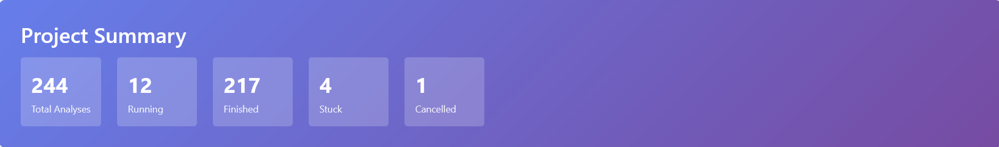

:page_template: homepage.html

Manage and automate analyses with ``asimov``
============================================

.. raw:: html

	
Workflow orchestration for scientific analyses on HTCondor and Slurm clusters.

	

	
<pre>$ pip install asimov</pre>

	<a class="btn btn-lg btn-primary fw-semibold" href="getting-started.html"><i class="bi bi-book"></i>Quickstart guide</a>
	

Asimov sets up, submits, monitors and reports on scientific analysis jobs, and records everything
it does in a database so that results can be reproduced. It is used in production for
gravitational-wave analysis by LIGO, Virgo and KAGRA, and works with any pipeline
that can be described through its plugin interface, whether you are analysing one event or
hundreds.

.. raw:: html

	

	

	<h3><a class="stretched-link" href="getting-started.html">Get started</a></h3>
	
Install asimov and run your first analysis in a few minutes.

	

	

	<h3><a class="stretched-link" href="ledger.html">Understanding projects</a></h3>
	
How projects, events and analyses are recorded, versioned and shared.

	

	

	<h3><a class="stretched-link" href="pipelines.html">Pipelines</a></h3>
	
One configuration, many pipelines: bilby, RIFT, BayesWave, LALInference or your own.

	

	

	<h3><a class="stretched-link" href="user-guide/running.html">Run and monitor</a></h3>
	
Submit jobs to HTCondor or Slurm, watch them, and recover from failures.

	

	

	<h3>User Guide</h3>
	
Explore the full documentation: <a href="rest-api.html">REST API</a>, <a href="python-api.html">Python API</a>, <a href="configuration.html">configuration</a> and the <a href="vocabulary.html">ledger vocabulary</a>.

	

	

	<h3><a class="stretched-link" href="tutorials/analysing-gw150914.html">Tutorials</a></h3>
	
Worked examples, from analysing GW150914 to writing a new pipeline.

	

	

   The project report shows live counts of analyses by status. See the :doc:`reporting guide <user-guide/reporting>`.

If you use asimov in a publication, please see the :ref:`citation-guide`.

.. toctree::
   :hidden:
   :maxdepth: 2
   :caption: 📚 Users' guide

   getting-started
   installation
   user-guide/projects
   user-guide/events
   user-guide/productions
   user-guide/running
   user-guide/monitoring
   user-guide/reporting
   storage
   user-guide/review
   citing

.. toctree::
   :hidden:
   :maxdepth: 2
   :caption: The Ledger

   ledger
   vocabulary

.. toctree::
   :hidden:
   :maxdepth: 1
   :caption: Pipeline Guides

   pipelines
   pipelines/lalinference
   pipelines/bilby
   pipelines/rift
   pipelines/bayeswave
   pipelines/pesummary
   pipelines/command

.. toctree::
   :hidden:
   :maxdepth: 2
   :caption: Advanced topics

   analyses
   analysis-types
   blueprints
   priors
   environment-reproducibility
   provenance
   principals
   audit
   mcp
   registry
   build-process
   scheduler-integration
   dag-translation-examples
   monitor-state-machine
   labeller-plugins
   monitor-api
   configuration
   test-interface
   clusters
   gracedb
   advanced/projects

.. toctree::
   :hidden:
   :maxdepth: 1
   :caption: Development Guide

   contributing.rst
   code-of-conduct.rst

   asimov-repository
   code-overview
   pipelines-dev
   hooks
   building-docs

.. toctree::
   :hidden:
   :maxdepth: 1
   :caption: Tutorials

   tutorials/when-something-goes-wrong
   tutorials/scaling-up
   tutorials/analysing-gw150914
   tutorials/python-api-tutorial
   tutorials/adding-a-pipeline
   tutorials/remixing-analyses

.. toctree::
   :hidden:
   :maxdepth: 2
   :caption: REST API

   rest-api

.. toctree::
   :hidden:
   :maxdepth: 1
   :caption: Python API

   python-api
   api/project
   api/asimov
   api/condor
   api/event
   api/git
   api/ini
   api/ledger
   api/locutus
   api/logging
   api/mattermost
   api/olivaw
   api/pipeline
   api/schedulers
   config

.. toctree::
   :hidden:
   :maxdepth: 1
   :caption: LIGO Analysis Cookbook

   ligo-cookbook/bayeswave
   ligo-cookbook/bilby
   ligo-cookbook/defaults
   ligo-cookbook/working-with-gwosc

